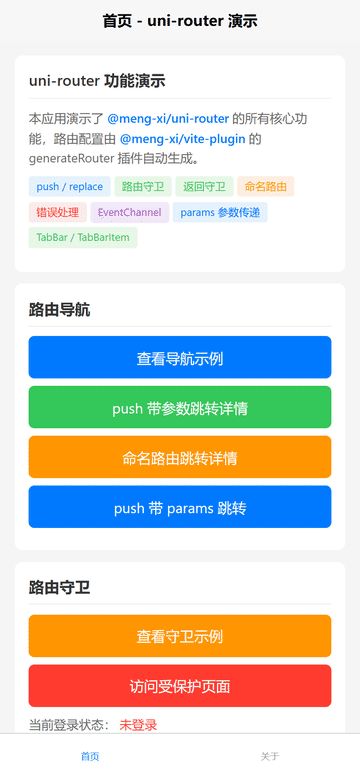

[中文](./README.md) | **English**

<div align="center">
	<a href="https://github.com/MengXi-Studio/uni-router">
		
	</a>
	<a href="https://github.com/MengXi-Studio/uni-router">
		
	</a>
	<br>
	<h1>@meng-xi/uni-router</h1>
	<p>A routing system for uni-app that feels like vue-router</p>

[](LICENSE) [](https://www.npmjs.com/package/@meng-xi/uni-router)


[Docs](https://mengxi-studio.github.io/uni-router/) · [Changelog](https://mengxi-studio.github.io/uni-router/en/changelog.html) · [npm](https://www.npmjs.com/package/@meng-xi/uni-router)


<p><sub>H5: home → detail → browser back, with the back guard in action</sub></p>

</div>

---

## Why uni-router

In uni-app, `navigateTo` / `redirectTo` / `reLaunch` / `switchTab` / `navigateBack` are scattered across call sites. Page params, authentication, unsaved-changes confirmation and back interception usually end up being re-implemented on every page — and any inconsistency leads to missed guards or broken navigation.

uni-router unifies all of this behind a vue-router-style API:

- **One definition, one behavior** - A single entry point for all navigation; TabBar routes automatically use `switchTab`, so business code no longer branches on page type
- **Guards configured once, effective everywhere** - Auth, redirects and leave confirmation live in the guard chain; cold-start pages run the same guards
- **Native back is covered too** - App hardware back and H5 browser back / back gesture plug into the same back guard
- **Plugins on demand** - Params / Channel / Animation / Interceptor are registered only when needed, and unused features throw a clear error instead of silently doing nothing

## Compared with native navigation APIs

| Scenario | Native uni APIs | uni-router |
| --- | --- | --- |
| Page navigation | Pick `navigateTo` / `redirectTo` / `reLaunch` / `switchTab` manually per page type | One set of `push` / `replace` / `relaunch` / `back`; TabBar routes automatically use `switchTab` |
| Repeated taps / concurrent navigation | Deduplicated in every page | Duplicate navigations rejected, concurrent navigations queued |
| Auth | Checked in each page's `onLoad` / `onShow` | Configured once in `beforeEach`; cold-start pages covered by `guardRoute()` |
| Leave confirmation / back interception | `onBackPress` returns synchronously, so it cannot await user confirmation | `onBeforeRouteLeave` / `onBeforeBack` support async confirmation and redirects |
| H5 browser back | Must listen to `popstate` yourself and reconcile it with the page stack | `onBeforeBack` intercepts browser back / back gesture directly |
| Complex params | Build URLs (with serialization) or use global variables | `params` passed implicitly, optionally persisted; URLs stay clean |
| Page communication | Create / pass an `EventChannel` manually on `push` | `usePageChannel()` built-in manager, with an optional global event bus |
| Route type hints | Hand-written path strings, easy to mistype | Route types generated by `@meng-xi/vite-plugin`, with name/path autocompletion |

## Core Capabilities

| Area | Capability |
| --- | --- |
| Navigation | Unified `push` / `replace` / `relaunch` / `back`; TabBar routes automatically switch to `switchTab`; duplicate navigations are rejected, concurrent navigations are queued |
| Guards | `beforeEach` / `beforeResolve` / `afterEach` / `beforeEnter` / `onBeforeRouteLeave` / `onBeforeBack`, with async support, redirects, controllable redirect modes and timeout protection |
| Back interception | Intercepts App hardware back / navigation-bar back / `navigateBack`, and H5 browser back / back gesture; `app.setSideSlipGesture` controls the iOS side-slip gesture |
| Cold start | `guardRoute()` re-runs the guard chain for pages opened directly via H5 URL, Mini-Program scene or App deep link, with redirect and abort callbacks |
| Page params | `params` passes complex data without exposing it in the URL, optionally persisted to storage; `query` offers `queryInt()` / `queryNumber()` / `queryBool()` |
| Page communication | `usePageChannel()` built-in manager; `push` uses the native `EventChannel` by default, and every navigation method supports it once `useUniEventChannel` is enabled |
| Declarative navigation | `RouterLink` (renders a native `<a>` tag on H5) + `TabBar` / `TabBarItem` (badges, red dot, safe area, before-change interception, SCSS theming) |
| Navigation animation | `push` / `replace` / `back` accept animation params with `meta.animation` defaults; native window animations on App, back exit animation on H5 |
| State & types | `app.use(router)` injects a global mixin that auto-invokes `syncRoute()` on each page's `onShow`; `@meng-xi/vite-plugin` generates route types with name/path autocompletion |
| Error handling | `RouterError` / `NavigationFailure` / `UniApiError` with `RouterErrorCode`; `isNavigationFailure()` for precise discrimination |

## Quick Start

```bash
pnpm add @meng-xi/uni-router
```

Optionally use [`@meng-xi/vite-plugin`](https://github.com/MengXi-Studio/vite-plugin) to auto-generate route config and type declarations from `pages.json`:

```bash
pnpm add @meng-xi/vite-plugin -D
```

### 1. Create Router

```typescript
// src/main.ts
import { createSSRApp } from 'vue'
import { createRouter, ParamsPlugin, ChannelPlugin, InterceptorPlugin } from '@meng-xi/uni-router'
import routes from './router.config'
import App from './App.vue'

const router = createRouter({
	routes,
	plugins: [ParamsPlugin, ChannelPlugin, InterceptorPlugin], // Register plugins on demand
	interceptUniApi: true // Requires InterceptorPlugin; intercept native APIs so guards always run
})

export function createApp() {
	const app = createSSRApp(App)
	app.use(router) // Injects a global mixin that auto-invokes syncRoute() on each page's onShow
	return { app }
}
```

### 2. Route Navigation

```typescript
const router = useRouter()

// Resolves to a NavigationResult (eventChannel available on push by default, for page communication)
await router.push({ path: '/pages/about/about', query: { id: '1' } })
await router.push({ name: 'about' })
await router.push({ path: '/pages/detail/detail', params: { info: { name: 'Tom' } } })

// Resolves to the updated target RouteLocation
await router.back()
```

> If the target route is declared as a TabBar page via `meta.isTab`, `push` / `replace` / `relaunch` automatically switch to `uni.switchTab`.

### 3. Route Guards

```typescript
router.beforeEach((to, from) => {
	if (to.meta.requireAuth && !isLoggedIn()) {
		return { name: 'login' } // redirect
	}
	// return undefined or true to proceed
})

// Back guard (onBeforeBack): intercepts App hardware back / navigation-bar back / navigateBack, and H5 back
router.onBeforeBack((to, from) => {
	if (from.meta.requireConfirm) {
		// return false to block, true / undefined to allow; a redirect route may also be returned
		return new Promise(resolve => {
			uni.showModal({
				title: 'Confirm',
				content: 'Are you sure you want to go back?',
				success: res => resolve(res.confirm)
			})
		})
	}
})

// Cold-start guard (guardRoute): re-runs the guard chain for pages entered via
// H5 URL / Mini-Program scene / App deep link. Usually placed in App.vue's onLaunch.
router.isReady().then(() => {
	router.guardRoute(undefined, {
		onAbort: () => router.relaunch('/pages/index/index')
	})
})
```

### 4. Components

```vue
<!-- RouterLink: declarative navigation -->
<RouterLink :to="{ name: 'about' }">About</RouterLink>

<!-- TabBar / TabBarItem: custom bottom navigation -->
<TabBar :before-change="onBeforeChange">
	<TabBarItem to="/pages/index/index" icon-path="/static/home.png" text="Home" />
	<TabBarItem to="/pages/about/about" icon-path="/static/user.png" text="Profile" badge="5" />
</TabBar>
```

## Router Options

`createRouter` accepts the following common options:

| Option               | Type               | Default | Description                                                                                |
| -------------------- | ------------------ | ------- | ------------------------------------------------------------------------------------------ |
| `routes`             | `RouteConfig[]`    | -       | Route config, must match the `pages.json` declarations                                     |
| `strict`             | `boolean`          | `true`  | Strict mode, throws when a named route is not matched                                      |
| `guardTimeout`       | `number`           | `10000` | Guard timeout (ms); warns and aborts navigation on timeout, set `0` to disable             |
| `readyTimeout`       | `number`           | `0`     | Ready timeout (ms); prevents `await router.isReady()` from hanging                         |
| `plugins`            | `RouterPlugin[]`   | `[]`    | Plugins registered on demand                                                               |
| `paramsPersistent`   | `boolean`          | `false` | Whether `params` persist to storage by default (requires ParamsPlugin)                     |
| `useUniEventChannel` | `boolean`          | `false` | Use the built-in communication manager for all navigation methods (requires ChannelPlugin) |
| `interceptUniApi`    | `boolean`          | `false` | Intercept native uni navigation APIs so guards always run (requires InterceptorPlugin)     |
| `app`                | `AppRouterOptions` | -       | App-specific config, e.g. `setSideSlipGesture` for the iOS side-slip gesture               |

## Platform Support

| Platform    | Navigation                                              | Back interception                                         | Animation                  |
| ----------- | ------------------------------------------------------- | --------------------------------------------------------- | -------------------------- |
| App         | `push` / `replace` / `relaunch` / `back` / `switchTab`  | Hardware back / navigation-bar back / `navigateBack`      | Native window animation    |
| H5          | Same as above                                           | Browser back / back gesture                               | Back exit animation (CSS)  |
| Mini Program| Same as above                                           | Native back button cannot be intercepted (platform limit) | Controlled by the host     |

## More

- **uni_modules build** - The repo ships `uni_modules/mxuni-router-v2`; HBuilderX projects can drop it into `uni_modules` directly. Its API matches the npm package
- **Error handling** - Navigation failures throw `NavigationFailure`; use `isNavigationFailure(error, RouterErrorCode.XXX)` instead of comparing strings

## Documentation

[https://mengxi-studio.github.io/uni-router/](https://mengxi-studio.github.io/uni-router/)

## Changelog

[https://mengxi-studio.github.io/uni-router/en/changelog.html](https://mengxi-studio.github.io/uni-router/en/changelog.html)

## License

[MIT](LICENSE)
