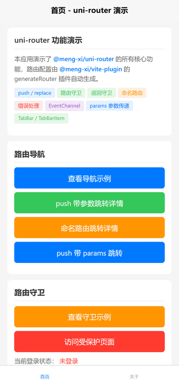

**中文** | [English](./README-en.md)

<div align="center">
	<a href="https://github.com/MengXi-Studio/uni-router">
		
	</a>
	<a href="https://github.com/MengXi-Studio/uni-router">
		
	</a>
	<br>
	<h1>@meng-xi/uni-router</h1>
	<p>为 uni-app 打造的路由管理系统，写起来像 vue-router</p>

[](LICENSE) [](https://www.npmjs.com/package/@meng-xi/uni-router)


[文档](https://mengxi-studio.github.io/uni-router/) · [更新日志](https://mengxi-studio.github.io/uni-router/changelog.html) · [npm](https://www.npmjs.com/package/@meng-xi/uni-router)


<p><sub>H5：首页 → 详情 → 浏览器后退，返回守卫生效</sub></p>

</div>

---

## 为什么是 uni-router

uni-app 原生的 `navigateTo` / `redirectTo` / `reLaunch` / `switchTab` / `navigateBack` 分散在各个调用点，页面传参、登录鉴权、未保存离开确认、返回拦截往往要在每个页面各写一遍，稍有不一致就会出现漏拦截、跳转错乱。

uni-router 用一套 vue-router 风格的 API 收敛这些场景：

- **一处定义，处处一致** - 四种导航统一入口，`meta.isTab` 页面自动走 `switchTab`，业务代码不再判断页面类型
- **守卫一次配置，全端生效** - 鉴权、重定向、离开确认集中在守卫链；冷启动直达的页面同样补跑守卫
- **原生返回也能管住** - App 返回键、H5 浏览器后退 / 后退手势都接入同一套返回守卫
- **按需插件，不为没用到的能力买单** - Params / Channel / Animation / Interceptor 按需注册，未注册即明确报错

## 和原生导航 API 对比

| 场景 | 原生 uni API | uni-router |
| --- | --- | --- |
| 页面跳转 | 按页面类型手动选择 `navigateTo` / `redirectTo` / `reLaunch` / `switchTab` | 统一 `push` / `replace` / `relaunch` / `back`，TabBar 页面自动走 `switchTab` |
| 重复点击 / 并发跳转 | 各页面自行去重 | 重复导航自动拒绝，并发导航自动排队 |
| 登录鉴权 | 每个页面 `onLoad` / `onShow` 各判断一次 | `beforeEach` 一处配置；冷启动直达页由 `guardRoute()` 补齐 |
| 离开确认 / 返回拦截 | `onBackPress` 同步返回，无法弹窗等待用户确认 | `onBeforeRouteLeave` / `onBeforeBack` 支持异步确认与重定向 |
| H5 浏览器后退 | 需自行监听 `popstate` 并与页面栈对齐 | `onBeforeBack` 直接拦截浏览器后退 / 后退手势 |
| 复杂参数传递 | 拼 URL（需序列化）或塞全局变量 | `params` 隐式传递，可选持久化；URL 保持干净 |
| 页面间通信 | `push` 时手动创建 / 传递 `EventChannel` | `usePageChannel()` 内置管理器，可选全局事件总线 |
| 路由类型提示 | 手写路径字符串，易拼错 | 配合 `@meng-xi/vite-plugin` 生成类型，名称与路径自动补全 |

## 核心能力

| 分类 | 能力 |
| --- | --- |
| 导航 | `push` / `replace` / `relaunch` / `back` 统一入口；TabBar 页面自动切换 `switchTab`；重复导航自动拒绝，并发导航自动排队 |
| 守卫 | `beforeEach` / `beforeResolve` / `afterEach` / `beforeEnter` / `onBeforeRouteLeave` / `onBeforeBack`，支持异步、重定向、可控重定向模式与超时保护 |
| 返回拦截 | App 物理返回键 / 导航栏返回 / `navigateBack`、H5 浏览器后退 / 后退手势均可拦截；`app.setSideSlipGesture` 控制 iOS 侧滑返回 |
| 冷启动守卫 | `guardRoute()` 为 H5 URL、小程序场景值、App deeplink 直达的页面补执行守卫链，支持重定向与中止回调 |
| 页面传参 | `params` 传递复杂数据不暴露在 URL，可持久化到 storage；`query` 提供 `queryInt()` / `queryNumber()` / `queryBool()` |
| 页面通信 | `usePageChannel()` 内置通信管理器；`push` 默认使用原生 `EventChannel`，开启 `useUniEventChannel` 后所有导航方式均可用 |
| 声明式导航 | `RouterLink`（H5 端渲染原生 `<a>` 标签）+ `TabBar` / `TabBarItem`（徽标、小红点、安全区、切换前拦截、SCSS 主题） |
| 导航动画 | `push` / `replace` / `back` 支持动画参数，`meta.animation` 设置默认；App 原生窗口动画，H5 返回退出动画 |
| 状态与类型 | `app.use(router)` 注入全局 Mixin，页面 `onShow` 自动 `syncRoute()`；配合 `@meng-xi/vite-plugin` 生成路由类型，名称与路径自动补全 |
| 错误处理 | `RouterError` / `NavigationFailure` / `UniApiError` 与 `RouterErrorCode` 错误码，`isNavigationFailure()` 精准判断失败类型 |

## 快速开始

```bash
pnpm add @meng-xi/uni-router
```

配合 [`@meng-xi/vite-plugin`](https://github.com/MengXi-Studio/vite-plugin) 从 `pages.json` 自动生成路由配置和类型声明：

```bash
pnpm add @meng-xi/vite-plugin -D
```

### 1. 创建路由器

```typescript
// src/main.ts
import { createSSRApp } from 'vue'
import { createRouter, ParamsPlugin, ChannelPlugin, InterceptorPlugin } from '@meng-xi/uni-router'
import routes from './router.config'
import App from './App.vue'

const router = createRouter({
	routes,
	plugins: [ParamsPlugin, ChannelPlugin, InterceptorPlugin], // 按需注册插件
	interceptUniApi: true // 需要 InterceptorPlugin，拦截原生 API 确保守卫生效
})

export function createApp() {
	const app = createSSRApp(App)
	app.use(router) // 注入全局 mixin，onShow 时自动 syncRoute()
	return { app }
}
```

### 2. 路由导航

```typescript
const router = useRouter()

// 返回 NavigationResult（默认仅 push 含 eventChannel，可页面间通信）
await router.push({ path: '/pages/about/about', query: { id: '1' } })
await router.push({ name: 'about' })
await router.push({ path: '/pages/detail/detail', params: { info: { name: 'Tom' } } })

// 返回更新后的目标路由位置（RouteLocation）
await router.back()
```

> 目标路由若在 `meta.isTab` 中声明为 TabBar 页面，`push` / `replace` / `relaunch` 会自动改用 `uni.switchTab`。

### 3. 路由守卫

```typescript
router.beforeEach((to, from) => {
	if (to.meta.requireAuth && !isLoggedIn()) {
		return { name: 'login' } // 重定向
	}
	// 不返回值或 return true 表示放行
})

// 返回守卫（onBeforeBack）：拦截 App 物理返回键 / 导航栏返回 / navigateBack、H5 后退
router.onBeforeBack((to, from) => {
	if (from.meta.requireConfirm) {
		// 返回 false 阻止返回，true / undefined 放行；也可 return 重定向路由
		return new Promise(resolve => {
			uni.showModal({
				title: '提示',
				content: '确认返回？',
				success: res => resolve(res.confirm)
			})
		})
	}
})

// 冷启动守卫（guardRoute）：H5 URL / 小程序场景值 / App deeplink 直达页面时补执行守卫链
// 通常放在 App.vue 的 onLaunch 中
router.isReady().then(() => {
	router.guardRoute(undefined, {
		onAbort: () => router.relaunch('/pages/index/index')
	})
})
```

### 4. 组件

```vue
<!-- RouterLink：声明式导航 -->
<RouterLink :to="{ name: 'about' }">关于</RouterLink>

<!-- TabBar / TabBarItem：自定义底部导航 -->
<TabBar :before-change="onBeforeChange">
	<TabBarItem to="/pages/index/index" icon-path="/static/home.png" text="首页" />
	<TabBarItem to="/pages/about/about" icon-path="/static/user.png" text="我的" badge="5" />
</TabBar>
```

## 路由选项

`createRouter` 支持以下常用选项：

| 选项                 | 类型               | 默认值  | 说明                                                        |
| -------------------- | ------------------ | ------- | ----------------------------------------------------------- |
| `routes`             | `RouteConfig[]`    | -       | 路由配置，需与 `pages.json` 声明一致                        |
| `strict`             | `boolean`          | `true`  | 严格模式，未匹配的命名路由抛出异常                          |
| `guardTimeout`       | `number`           | `10000` | 守卫超时（ms），超时警告并自动中止导航，设 `0` 关闭         |
| `readyTimeout`       | `number`           | `0`     | 就绪超时（ms），防止 `await router.isReady()` 挂起          |
| `plugins`            | `RouterPlugin[]`   | `[]`    | 按需注册插件                                                |
| `paramsPersistent`   | `boolean`          | `false` | params 是否默认持久化到 storage（需 ParamsPlugin）          |
| `useUniEventChannel` | `boolean`          | `false` | 所有导航方式均使用内置通信管理器（需 ChannelPlugin）        |
| `interceptUniApi`    | `boolean`          | `false` | 拦截 uni 原生导航 API，确保守卫生效（需 InterceptorPlugin） |
| `app`                | `AppRouterOptions` | -       | App 专属配置，如 `setSideSlipGesture` 控制 iOS 侧滑返回手势 |

## 平台支持

| 平台   | 导航                                                   | 返回拦截                                  | 动画                       |
| ------ | ------------------------------------------------------ | ----------------------------------------- | -------------------------- |
| App    | `push` / `replace` / `relaunch` / `back` / `switchTab` | 物理返回键 / 导航栏返回 / `navigateBack`  | 原生窗口动画               |
| H5     | 同上                                                   | 浏览器后退 / 后退手势                     | 返回退出动画（CSS 过渡）   |
| 小程序 | 同上                                                   | 原生返回按钮无法拦截（平台限制）          | 由宿主控制                 |

## 更多

- **uni_modules 版本** - 仓库提供 `uni_modules/mxuni-router-v2`，HBuilderX 项目可直接放入 `uni_modules` 目录使用；API 与 npm 版本一致
- **错误处理** - 导航失败统一抛出 `NavigationFailure`，通过 `isNavigationFailure(error, RouterErrorCode.XXX)` 判断类型，不做字符串比较

## 文档

[https://mengxi-studio.github.io/uni-router/](https://mengxi-studio.github.io/uni-router/)

## 更新日志

[https://mengxi-studio.github.io/uni-router/changelog.html](https://mengxi-studio.github.io/uni-router/changelog.html)

## License

[MIT](LICENSE)
