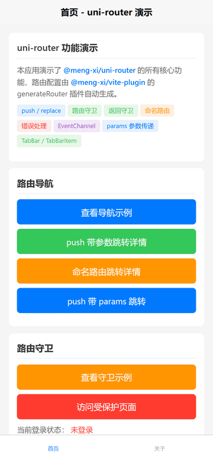

<div align="center">
	<a href="https://github.com/MengXi-Studio/uni-router">
		
	</a>
	<a href="https://github.com/MengXi-Studio/uni-router">
		
	</a>
	<br>
	<h1>@meng-xi/uni-router</h1>
	<p>为 uni-app 打造的路由管理系统，写起来像 vue-router</p>
	<p><sub>uni_modules 版本 · 仅支持 Vue 3</sub></p>

[](LICENSE) [](https://www.npmjs.com/package/@meng-xi/uni-router)


[文档](https://mengxi-studio.github.io/uni-router/) · [更新日志](https://mengxi-studio.github.io/uni-router/changelog.html) · [npm 版本](https://www.npmjs.com/package/@meng-xi/uni-router)


<p><sub>H5：首页 → 详情 → 浏览器后退，返回守卫生效</sub></p>

</div>

---

> **仅支持 Vue 3** - 基于 Vue 3 Composition API，不支持 Vue 2 项目。API 与 npm 版本一致，无需 npm 安装，复制目录即可使用。

## 为什么是 uni-router

uni-app 原生的 `navigateTo` / `redirectTo` / `reLaunch` / `switchTab` / `navigateBack` 分散在各个调用点，页面传参、登录鉴权、未保存离开确认、返回拦截往往要在每个页面各写一遍，稍有不一致就会出现漏拦截、跳转错乱。

uni-router 用一套 vue-router 风格的 API 收敛这些场景：

- **一处定义，处处一致** - 四种导航统一入口，`meta.isTab` 页面自动走 `switchTab`，业务代码不再判断页面类型
- **守卫一次配置，全端生效** - 鉴权、重定向、离开确认集中在守卫链；冷启动直达的页面同样补跑守卫
- **原生返回也能管住** - App 返回键、H5 浏览器后退 / 后退手势都接入同一套返回守卫
- **按需插件，不为没用到的能力买单** - Params / Channel / Animation / Interceptor 按需注册，未注册即明确报错

## 和原生导航 API 对比

| 场景 | 原生 uni API | uni-router |
| --- | --- | --- |
| 页面跳转 | 按页面类型手动选择 `navigateTo` / `redirectTo` / `reLaunch` / `switchTab` | 统一 `push` / `replace` / `relaunch` / `back`，TabBar 页面自动走 `switchTab` |
| 重复点击 / 并发跳转 | 各页面自行去重 | 重复导航自动拒绝，并发导航自动排队 |
| 登录鉴权 | 每个页面 `onLoad` / `onShow` 各判断一次 | `beforeEach` 一处配置；冷启动直达页由 `guardRoute()` 补齐 |
| 离开确认 / 返回拦截 | `onBackPress` 同步返回，无法弹窗等待用户确认 | `onBeforeRouteLeave` / `onBeforeBack` 支持异步确认与重定向 |
| H5 浏览器后退 | 需自行监听 `popstate` 并与页面栈对齐 | `onBeforeBack` 直接拦截浏览器后退 / 后退手势 |
| 复杂参数传递 | 拼 URL（需序列化）或塞全局变量 | `params` 隐式传递，可选持久化；URL 保持干净 |
| 页面间通信 | `push` 时手动创建 / 传递 `EventChannel` | `usePageChannel()` 内置管理器，可选全局事件总线 |
| 路由类型提示 | 手写路径字符串，易拼错 | 可选配合 `@meng-xi/vite-plugin` 生成类型，名称与路径自动补全 |

## 核心能力

| 分类 | 能力 |
| --- | --- |
| 导航 | `push` / `replace` / `relaunch` / `back` 统一入口；TabBar 页面自动切换 `switchTab`；重复导航自动拒绝，并发导航自动排队 |
| 守卫 | `beforeEach` / `beforeResolve` / `afterEach` / `beforeEnter` / `onBeforeRouteLeave` / `onBeforeBack`，支持异步、重定向、可控重定向模式与超时保护 |
| 返回拦截 | App 物理返回键 / 导航栏返回 / `navigateBack`、H5 浏览器后退 / 后退手势均可拦截；`app.setSideSlipGesture` 控制 iOS 侧滑返回 |
| 冷启动守卫 | `guardRoute()` 为 H5 URL、小程序场景值、App deeplink 直达的页面补执行守卫链，支持重定向与中止回调 |
| 页面传参 | `params` 传递复杂数据不暴露在 URL，可持久化到 storage，`back()` 后自动保留；`query` 提供 `queryInt()` / `queryNumber()` / `queryBool()` |
| 页面通信 | `usePageChannel()` 内置通信管理器；`push` 默认使用原生 `EventChannel`，开启 `useUniEventChannel` 后所有导航方式均可用 |
| 声明式导航 | `RouterLink`（H5 端渲染原生 `<a>` 标签）+ `TabBar` / `TabBarItem`，easycom 自动注册，支持徽标、小红点、安全区、切换前拦截与 SCSS 主题 |
| 导航动画 | `push` / `replace` / `back` 支持动画参数，`meta.animation` 设置默认；App 原生窗口动画，H5 端 `push` / `back` 为 CSS 过渡 |
| 状态与类型 | 全局 Mixin 自动 `syncRoute()`（支持 `strict`）；`js_sdk` 同时提供 ESM 与 CJS 产物，TypeScript 类型提示开箱可用 |
| 错误处理 | `RouterError` / `NavigationFailure` / `UniApiError` 与 `RouterErrorCode` 错误码，`isNavigationFailure()` 精准判断失败类型 |

## 安装

将 `mxuni-router-v2` 目录复制到项目的 `uni_modules` 目录下即可，无需 npm 安装，也无需额外构建配置：

```
你的项目/
└── uni_modules/
    └── mxuni-router-v2/
        ├── js_sdk/         # ESM / CJS 产物
        ├── components/     # RouterLink / TabBar / TabBarItem（easycom）
        └── changelog.md
```

## 快速开始

### 1. 创建路由器

```typescript
// main.ts
import { createSSRApp } from 'vue'
import { createRouter, ParamsPlugin, ChannelPlugin, InterceptorPlugin, AnimationPlugin } from './uni_modules/mxuni-router-v2/js_sdk/index.js'
import App from './App.vue'

const router = createRouter({
	routes: [
		{ path: 'pages/index/index', name: 'home', meta: { title: '首页', isTab: true } },
		{ path: 'pages/about/about', name: 'about', meta: { requireAuth: true } }
	],
	plugins: [ParamsPlugin, ChannelPlugin, InterceptorPlugin, AnimationPlugin],
	interceptUniApi: true // 需要 InterceptorPlugin
})

export function createApp() {
	const app = createSSRApp(App)
	app.use(router) // 自动注册全局 mixin，onShow 时同步 currentRoute
	return { app }
}
```

### 2. 路由导航

```typescript
import { useRouter, useRoute } from './uni_modules/mxuni-router-v2/js_sdk/index.js'

const router = useRouter()
const route = useRoute()

await router.push({ path: '/pages/about/about', query: { id: '1' } })
await router.push({ name: 'about' })
await router.push({ path: '/pages/detail/detail', params: { info: { name: 'Tom' } } })
await router.back()
```

### 3. 路由守卫

```typescript
router.beforeEach((to, from) => {
	if (to.meta.requireAuth && !isLoggedIn()) {
		return { name: 'login' } // 重定向到登录页
	}
	// 不返回值（或 return true）表示放行
})

// 全局返回守卫：false 阻止返回，true / undefined 放行，支持异步（Promise）
router.onBeforeBack((to, from) => {
	if (hasUnsavedChanges) {
		return false // 阻止返回
	}
})
```

### 4. 组件

组件通过 easycom 自动注册，直接在模板中使用即可：

```vue
<!-- RouterLink：声明式导航 -->
<RouterLink :to="{ name: 'about' }">关于</RouterLink>

<!-- TabBar / TabBarItem：自定义底部导航 -->
<TabBar selected-color="#007aff">
	<TabBarItem to="/pages/index/index" icon-path="/static/home.png" text="首页" />
	<TabBarItem to="/pages/about/about" icon-path="/static/user.png" text="我的" dot />
</TabBar>
```

## 平台支持

| 平台   | 导航                                                   | 返回拦截                                  | 动画                     |
| ------ | ------------------------------------------------------ | ----------------------------------------- | ------------------------ |
| App    | `push` / `replace` / `relaunch` / `back` / `switchTab` | 物理返回键 / 导航栏返回 / `navigateBack`  | 原生窗口动画             |
| H5     | 同上                                                   | 浏览器后退 / 后退手势                     | `push` / `back` CSS 过渡 |
| 小程序 | 同上                                                   | 原生返回按钮无法拦截（平台限制）          | 由宿主控制               |

## 文档

[https://mengxi-studio.github.io/uni-router/](https://mengxi-studio.github.io/uni-router/)

版本变更见同目录 [changelog.md](./changelog.md)。

## License

[MIT](LICENSE)
